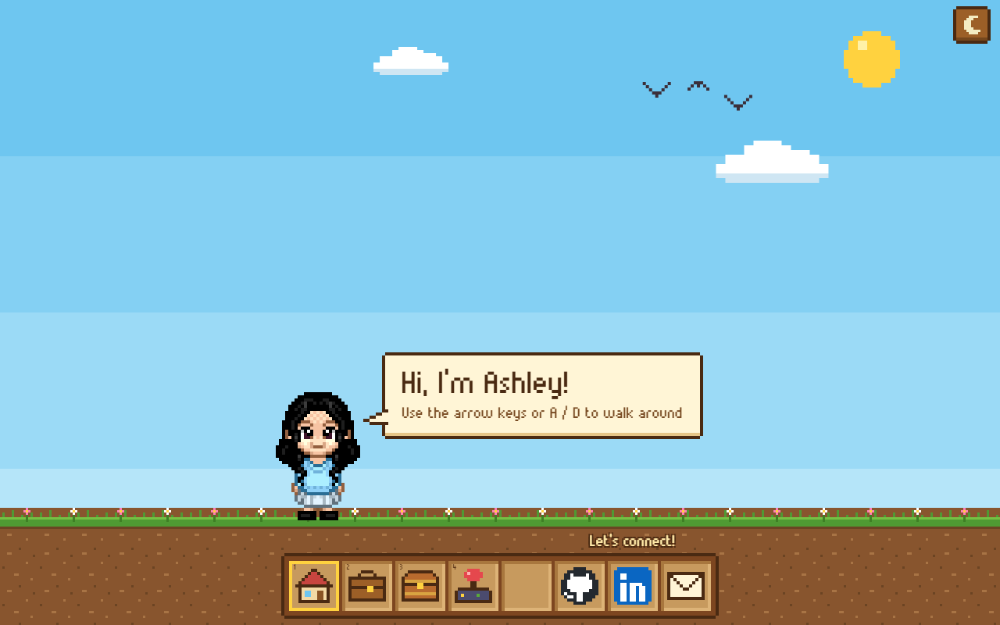
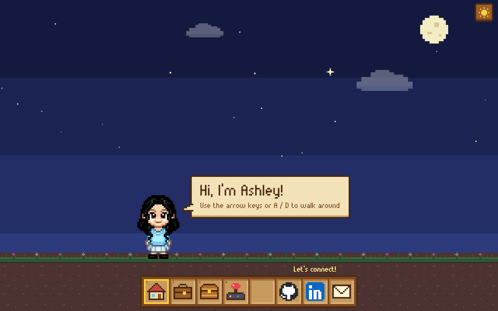
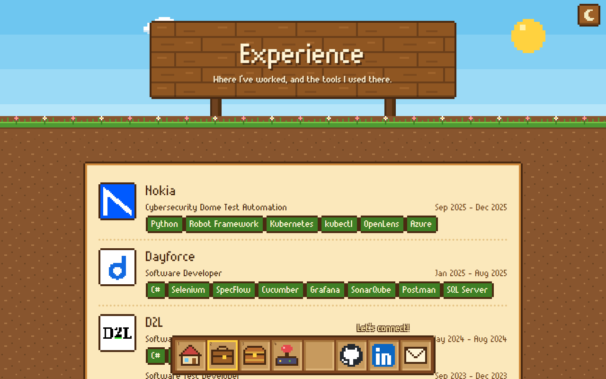
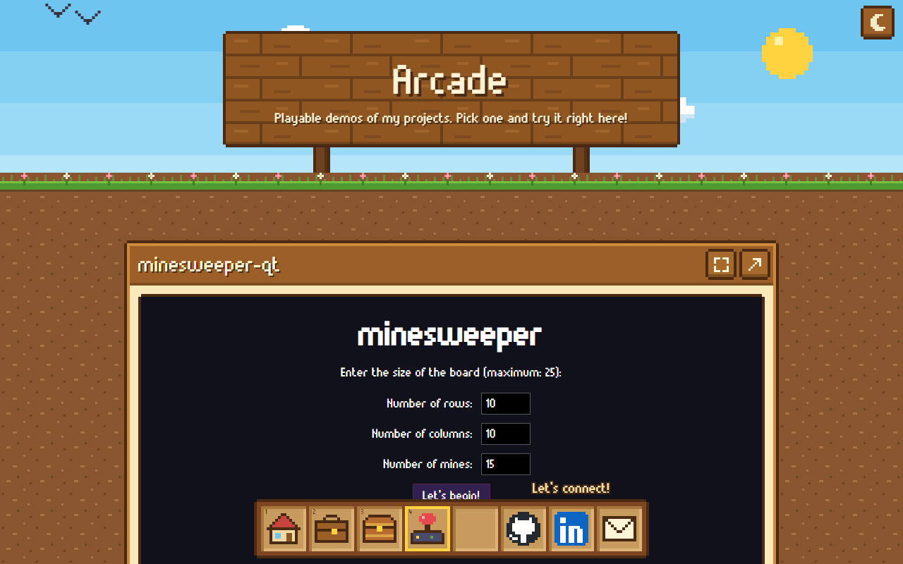

# ashleykimm.github.io

My personal website: [ashleykimm.github.io](https://ashleykimm.github.io)

avatar by [avatarsinpixels.com](https://www.avatarsinpixels.com/)

## Versions

Snapshots of how the site looked over time, newest first.

### 2026-11-22 — Pixel farm, walking avatar

The home page opens high in the sky and pans down to the ground, where I walk in and say hi.
Visitors can walk me around with the arrow keys or A / D. The inventory bar at the bottom
links to Experience, Projects and the Arcade (playable demos), plus GitHub, LinkedIn and email.
Going from Home to another page, the ground rises up into it.


| Home (day) | Home (night) |
| --- | --- |
|  |  |

| Experience | Projects |
| --- | --- |
|  |  |

| Arcade | Phone |
| --- | --- |
|  |  |

### Adding a new version

Take a fresh set of screenshots and a GIF tour into a dated folder, then add a section above:

```
node tools/capture-screenshots.mjs https://ashleykimm.github.io/ screenshots/YYYY-MM-DD
```

(Needs Microsoft Edge, Node 22+, and Python with Pillow.)
