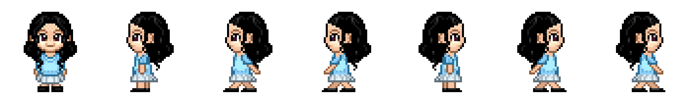
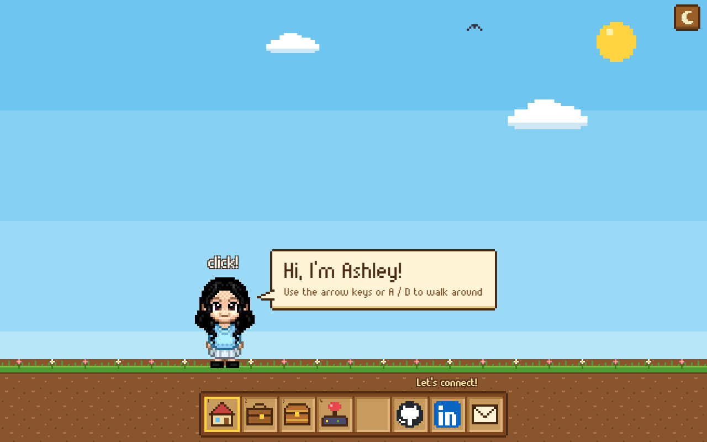
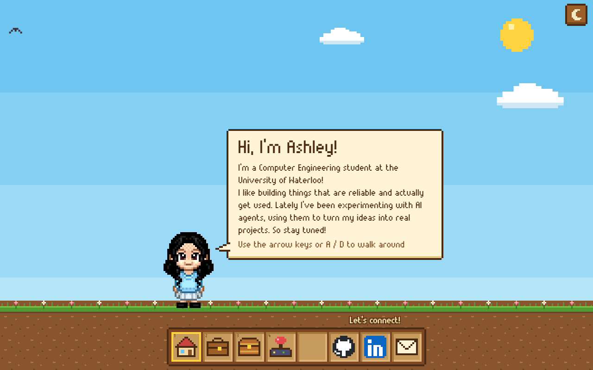
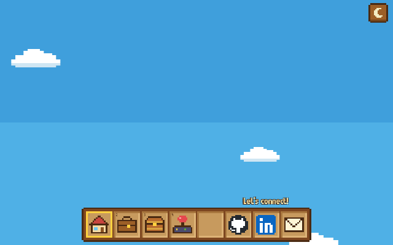
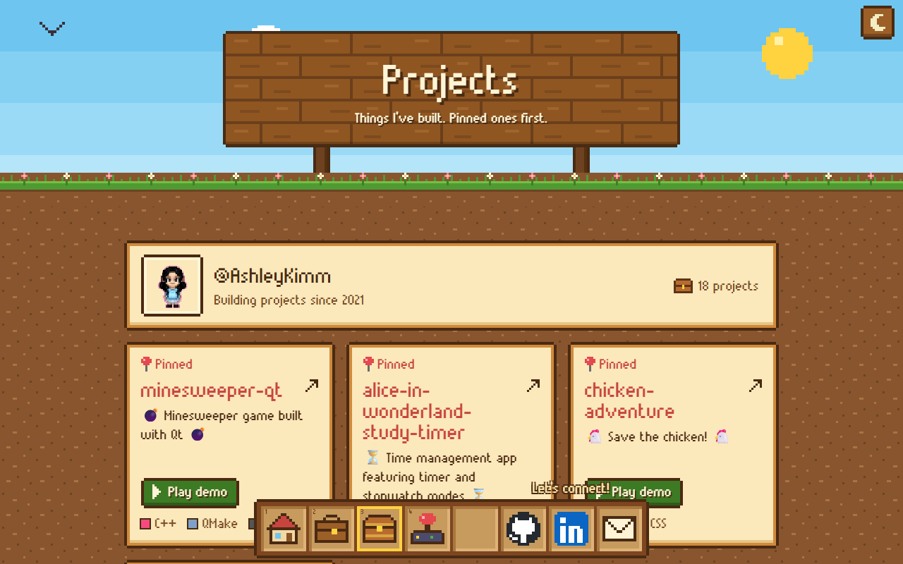

# ashleykimm.github.io

My personal website: [ashleykimm.github.io](https://ashleykimm.github.io)

avatar by [avatarsinpixels.com](https://www.avatarsinpixels.com/)



## Versions

Snapshots of how the site looked over time, newest first. Each update only shows what changed.

### 2026-11-22 (later) — Click! to learn more about me

| Click! | After clicking |
| --- | --- |
|  |  |

### 2026-11-22 — Pixel farm, walking avatar



| Home (day) | Home (night) |
| --- | --- |
|  |  |

| Experience | Projects |
| --- | --- |
|  |  |

| Arcade | Phone |
| --- | --- |
|  |  |

### Adding a new version

Take screenshots of the pages that changed into a dated folder, then add a section at the top of
Versions with just those. To capture the full set (every page plus a GIF tour) and keep the ones you need:

```
node tools/capture-screenshots.mjs https://ashleykimm.github.io/ screenshots/YYYY-MM-DD
```

(Needs Microsoft Edge, Node 22+, and Python with Pillow.)
